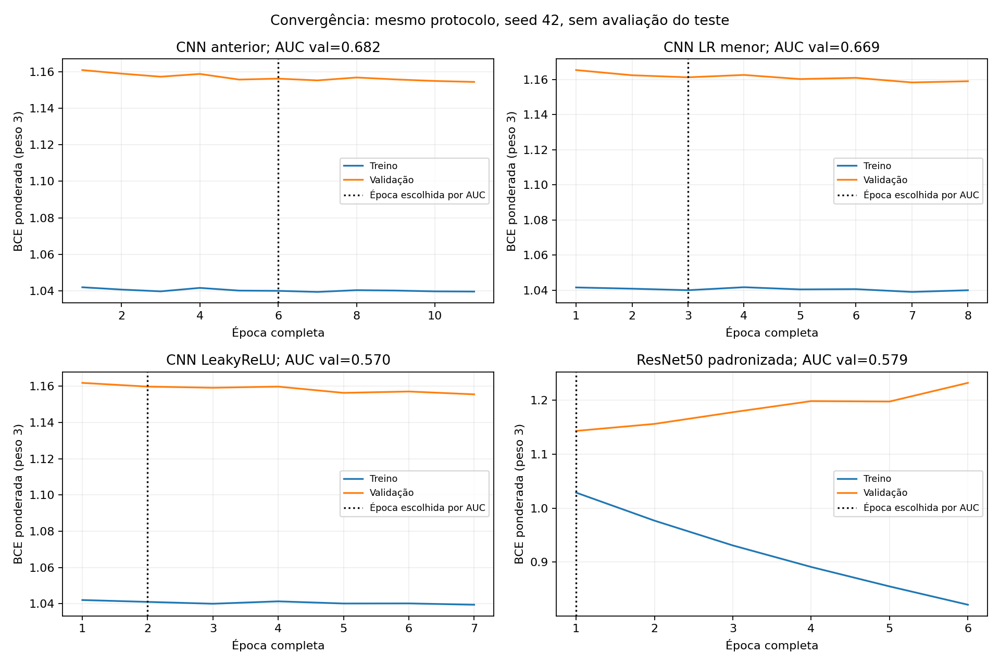
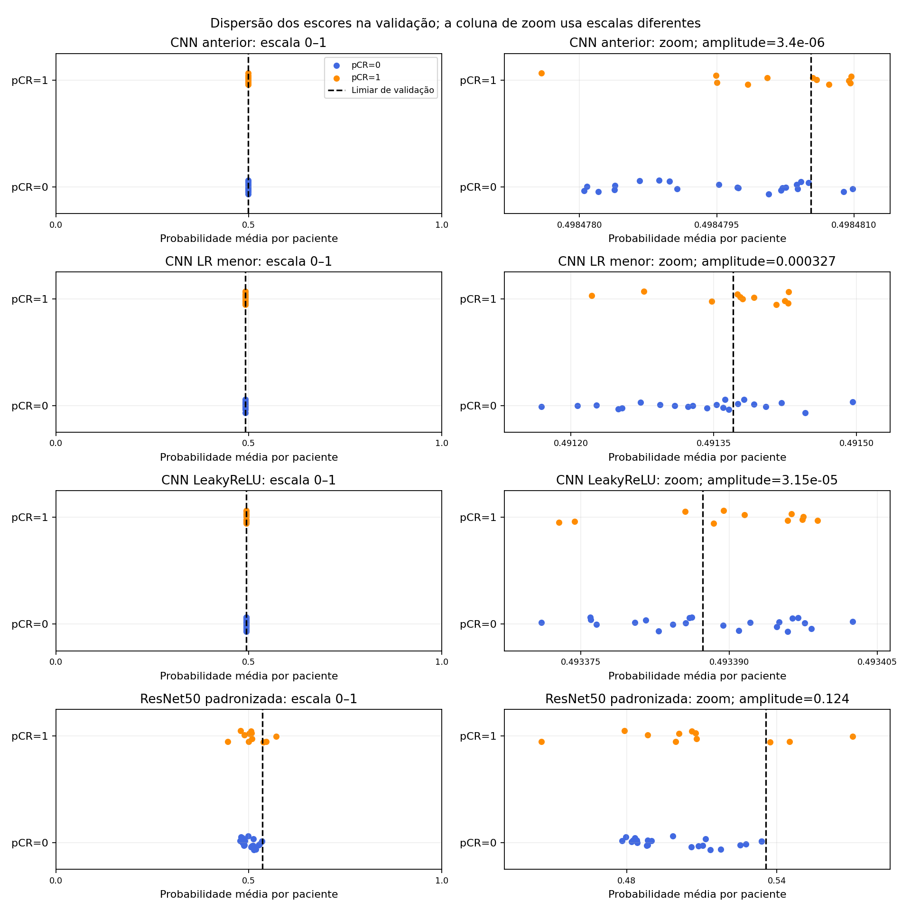
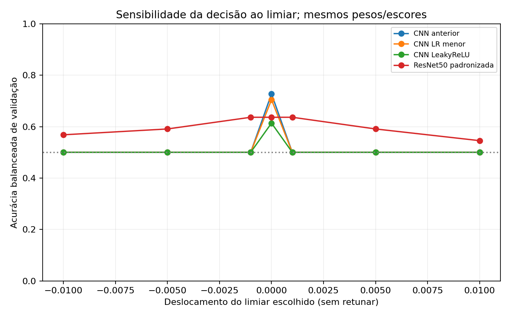

# Última rodada controlada — Issue #4

> **Atualização posterior:** a rodada definitiva de 12 novos treinamentos e o
> teste único dos 27 foram concluídos com autorização expressa do usuário.
> Ver [relatório definitivo](GRADE_DEFINITIVA_ISSUE_4_20261117.md). Os resultados
> e as restrições abaixo registram a sessão histórica dos três experimentos;
> seus artefatos foram preservados sem alteração.

**Estado final: três treinamentos concluídos; nenhuma melhoria convincente;
aguardando revisão do usuário antes da Etapa 3.**
Branch: `feature/felipe-issue4-finalizacao`. Etapa 3 proibida nesta execução.
Saída nova: `resultados/rodada_final_issue4_20261117_01/`.

## Leituras e preservação

Foram lidos integralmente FINALIZACAO_ISSUE_4.md, EXECUCAO_ISSUE_4_20261117.md,
REVISAO_ANTES_TESTE.md, as sete páginas do enunciado e a Issue #4 do GitHub
(aberta, sem comentários na consulta). A issue remota ainda contém o texto
histórico de que os treinamentos não foram executados; os resultados reais estão
registrados no repositório. Não fechar ou mesclar a issue nesta execução.
O arquivo `preservacao_antes.json` registra hashes/tamanhos de 266 artefatos
anteriores, incluindo os 12 checkpoints originais, as cópias com limiares
refinados e os quatro ajustes. Nenhum será substituído.

## Diagnóstico anterior aos novos treinamentos

Revisão: rótulos binários, separação por paciente antes do aumento, máscara fora
dos canais, três fases corretas, percentis por amostra, BCE com logits, backward,
optimizer.step, seed, BatchNorm congelada e época escolhida pela validação estão
coerentes. Não há interrupção após poucos lotes. A CNN tem quatro convoluções e
duas camadas lineares, cumprindo o mínimo de cinco camadas com parâmetros.

Probe **sem optimizer.step**, em oito pacientes de treino (quatro por classe):
imagens finitas em [0,1], desvio espacial médio 0,1853. A hipótese de imagens
uniformes após normalização não se confirmou nesse probe.
Esse probe 4/4 é comparativo e não reproduz a proporção 78/26 do treino inteiro;
as magnitudes de gradiente medidas nele não estimam o gradiente médio do treino.

Na inicialização seed 42, 16,4% dos canais da última ReLU foram totalmente zero;
no checkpoint CNN época 6, 87,5%. A fração de zeros nessa ativação passou de
55,9% para 90,5%. A variação entre pacientes caiu de 0,00205 para 0,000055;
na cabeça, de 0,000266 para 0,0000079. O gradiente da primeira convolução caiu
de norma 0,00135 para 0,0000356, mas não está completamente interrompido.
Isso sustenta colapso de representação/ativações e otimização insuficiente;
**não prova uma causa única** nem demonstra que toda ReLU está permanentemente
morta em todos os dados. Resultados completos em `diagnostico_cnn.json`.

Com 78/26 no treino e peso 3, um escore constante 0,5 produz loss ponderada
1,5×ln(2)=1,03972, próxima da curva quase plana da CNN. Esse é um ótimo
constante possível da perda ponderada; o peso não foi calculado incorretamente.
Global average pooling e dropout podem reduzir o sinal entre pacientes, mas
não serão alterados nesta rodada. A inicialização original não produz gradientes
nulos; não há evidência para atribuir o problema apenas à inicialização.

ResNet50/ImageNet: o pipeline atual normaliza para [0,1], mas não aplica os
valores de média/desvio esperados pelos pesos. Isso é uma possível incompatibilidade
de domínio/preprocessamento, não um erro comprovado que explique a CNN autoral.
Fonte: https://docs.pytorch.org/vision/0.24/models/generated/torchvision.models.resnet50.html

## Plano fechado: exatamente três experimentos, sem busca adicional

| ID | Base | Única intervenção principal | Hipótese |
|---|---|---|---|
| e1_cnn_lr_menor | CNN, post_early, maior tumor | LR 1e-3 → 3e-4 | Passos menores podem evitar colapso e permitir aprendizagem gradual. |
| e2_cnn_leaky | CNN, post_early, maior tumor | Cinco ReLUs → LeakyReLU(0,01) | Manter gradientes no lado negativo pode preservar informação e canais ativos. |
| e3_resnet_imagenet | ResNet50 congelada, três fases, maior tumor | Após percentis/aumento, aplicar média [0,485;0,456;0,406] e desvio [0,229;0,224;0,225] | Corrigir a escala esperada pelo extrator pré-treinado pode melhorar a separação sem liberar mais pesos. |

Comparadores: e1/e2 versus CNN original, mesma fase/corte/seed; e3 versus o
ajuste antigo `peso_3_congelada`, com mesma ResNet50 congelada, três fases,
maior tumor, LR e peso. Também comparar todos contra a melhor CNN antiga e
contra as 12 configurações anteriores. e3 **não** testa o pipeline ImageNet
completo: mantém 256×256 e não introduz resize/crop para preservar a região e
isolar a padronização. Fases temporais não são RGB; o benefício não é garantido.

Constantes: partições oficiais 104/33/35, seed 42, batch 4, Adam, weight decay
1e-4, BCEWithLogitsLoss(pos_weight=3), aumento ×10 em treino/validação, até 30
épocas completas, paciência 5, checkpoint por AUC de validação e desempate por
menor loss. Dropout 0,3 e pooling da CNN permanecem. LR de e2=1e-3; e3=1e-4.
e3 treina somente a cabeça, sem fine-tuning. Não testar novas seeds nesta rodada.

Os três treinamentos começam do zero ou dos mesmos pesos ImageNet oficiais,
sem continuar os checkpoints anteriores. Não haverá quarto treinamento ou
alteração dos parâmetros em resposta aos resultados intermediários.

## Avaliação e decisão registradas antes da execução

- Métricas por paciente: AUC primária, acurácia balanceada, sensibilidade,
  especificidade, precisão, F1, acurácia; loss ponderada e tempos/curvas.
- Limiar pelo mesmo método suplementar já usado no comparador: pontos médios
  de escores únicos de validação, extremos internos e 0,5, maximizando acurácia
  balanceada; desempates por especificidade, sensibilidade e proximidade de 0,5.
- Distribuição: amplitude, desvio, IQR e escores por classe; avaliar também treino
  para distinguir subajuste de sobreajuste. Limiar não altera AUC.
- Robustez descritiva: perturbar o limiar por ±0,001, ±0,005 e ±0,01, sem escolher
  novo limiar com esses resultados; comparar mudanças de classe e métricas.
- Bootstrap pareado estratificado por paciente, 2.000 reamostragens, seed 2026,
  para descrever incerteza da diferença de AUC em relação à melhor CNN antiga.
  Não tratar os dez aumentos como pacientes independentes; não alegar
  significância populacional com esta exploração de três candidatos.
- Recomendar para o teste apenas candidatos com AUC maior que 0,6818,
  acurácia balanceada e sensibilidade não inferiores a 0,7273 e 0,5455, que
  prevejam ambas as classes e cuja pior acurácia balanceada sob ±0,01 permaneça
  acima de 0,5. São regras comparativas para recomendar candidatos, não metas
  exigidas pelo professor ou garantia estatística. Se nenhum satisfizer, manter
  os anteriores e documentar o resultado negativo; não iniciar outra busca.

## Isolamento e integração

Novos módulos/scripts reutilizam os datasets, aumento, métricas e treinamento
existentes. Não modificar o comportamento padrão das Issues #1/#2/#3. A variante
LeakyReLU terá identidade e buffer próprios, impedindo carregar silenciosamente
seus pesos numa CNN ReLU. Normalização adicional será serializada no checkpoint
e reaplicada pelo carregador comum à validação e ao futuro teste.

Durante investigação, construir somente datasets de treino/validação. O novo
carregador deve recusar teste sem autorização explícita. Preparar, mas não
executar, um avaliador por manifesto para as 12 configurações preservadas e os
novos candidatos aprovados pela validação, em saídas separadas, sem escolher
vencedor pelo teste. A revisão do usuário continua obrigatória antes dessa etapa.

## Limitações e uso de IAG

O grupo já consultou resultados originais do teste antes da revisão anterior;
isso deve continuar declarado. Esta rodada usa exclusivamente treino/validação,
mas reutiliza os mesmos 33 pacientes após várias escolhas: os ganhos são
exploratórios e otimistas. Não prometer determinada porcentagem.

Codex foi utilizado para revisão de código/documentos, diagnóstico de ativações,
implementação dos controles e execução/análise dos experimentos. Incorporar o
prompt desta rodada e suas finalidades à declaração suplementar de IAG. Os
integrantes devem revisar o código, as justificativas e as análises para a entrega.
Solicitação desta rodada arquivada em
[PROMPT_RODADA_FINAL_ISSUE_4_20261117.md](PROMPT_RODADA_FINAL_ISSUE_4_20261117.md).

## Execuções e resultados reais de validação

Foram executados **exatamente três novos treinamentos**, sem repetir seeds ou
retreinar em resposta aos resultados. Todos completaram os lotes de cada época;
a parada foi a paciência 5 previamente definida. O teste não foi avaliado.

| Modelo | AUC | Ac. bal. | Sens. | Espec. | Precisão | F1 | Acurácia | Loss |
|---|---:|---:|---:|---:|---:|---:|---:|---:|
| CNN anterior, post_early/maior tumor | 0,6818 | 0,7273 | 0,5455 | 0,9091 | 0,7500 | 0,6316 | 0,7879 | 1,1563 |
| e1: CNN LR menor | 0,6694 | 0,7045 | 0,7273 | 0,6818 | 0,5333 | 0,6154 | 0,6970 | 1,1612 |
| e2: CNN LeakyReLU | 0,5702 | 0,6136 | 0,7273 | 0,5000 | 0,4211 | 0,5333 | 0,5758 | 1,1598 |
| e3: ResNet50 padronizada | 0,5785 | 0,6364 | 0,2727 | 1,0000 | 1,0000 | 0,4286 | 0,7576 | 1,1432 |

Tabela completa das **12 configurações anteriores e três candidatas**, com
hiperparâmetros nos JSONs e medidas de estabilidade:
[comparacao_validacao.csv](../../resultados/rodada_final_issue4_20261117_01/comparacao_validacao.csv)
e [comparacao_validacao.json](../../resultados/rodada_final_issue4_20261117_01/comparacao_validacao.json).
Todas usam o mesmo método de busca fina de limiar na validação; portanto, a
comparação acima não mistura a grade antiga de passo 0,05 com a busca refinada.

| Modelo | Época escolhida/total | Tempo treino (s) | Limiar completo | Amplitude dos escores | Pior ac. bal. em limiar ±0,01 |
|---|---:|---:|---:|---:|---:|
| CNN anterior | 6/11 | 117,1 | 0,49848052859306335 | 0,0000034034 | 0,5000 |
| e1 | 3/8 | 91,5 | 0,4913703888654709 | 0,0003270984 | 0,5000 |
| e2 | 2/7 | 82,4 | 0,49338732063770296 | 0,0000314832 | 0,5000 |
| e3 | 1/6 | 178,4 | 0,5356386035680771 | 0,1244537026 | 0,5455 |

### Interpretação por hipótese

**e1 — LR menor:** aumentou a dispersão dos escores, mas eles continuam estreitos.
AUC caiu 0,0124 e acurácia balanceada caiu 0,0227. Os positivos corretos passaram
de 6 para 8, porém os falsos positivos aumentaram de 2 para 7. O ganho de
sensibilidade é um compromisso entre erros, não melhora global demonstrada.
AUC no treino do checkpoint escolhido: 0,5375. A loss de treino permaneceu
próxima de 1,04 e a validação de 1,16: comportamento compatível com subajuste.

**e2 — LeakyReLU:** manteve o ramo negativo da ativação e os mesmos pesos
iniciais, mas não resolveu a pequena variação dos escores. AUC caiu 0,1116.
Acertou 8 positivos, mas produziu 11 falsos positivos. AUC de treino 0,5251;
loss de treino perto de 1,04. ReLUs inativas não eram uma explicação suficiente
para todo o problema; não se pode concluir que trocar a ativação, por si só,
restaurou capacidade discriminativa.

**e3 — padronização ImageNet:** os escores são mais espalhados e o limiar menos
frágil, mas a AUC permanece modesta e a sensibilidade é baixa (3 TP, 8 FN).
Precisão 1 e especificidade 1 refletem apenas três previsões positivas sem FP,
não um classificador perfeito. Contra a ResNet50 congelada antiga, que é o
controle tecnicamente pareado, AUC passou de 0,5496 para 0,5785 (+0,0289),
loss caiu de 1,1756 para 1,1432 e acurácia balanceada pela mesma busca fina
passou de 0,5909 para 0,6364. Há ganho pontual nesse controle, sem comprovação
robusta: IC95% bootstrap da diferença de AUC [-0,1612; 0,2190]. O checkpoint
novo fica abaixo da melhor CNN anterior e da ResNet50 com fine-tuning antiga
(AUC 0,6033). AUC de treino 0,8471 versus 0,5785 na validação, com loss de
treino caindo até 0,8207 e de validação subindo até 1,2324: há sobreajuste
mesmo treinando só a cabeça.

Bootstrap pareado, 2.000 reamostragens estratificadas por paciente, seed 2026,
comparando cada nova candidata com a melhor CNN antiga:

| Candidato | ΔAUC observado | IC95% percentil de ΔAUC |
|---|---:|---|
| e1 | -0,0124 | [-0,1446; 0,1240] |
| e2 | -0,1116 | [-0,2522; 0,0165] |
| e3 | -0,1033 | [-0,4132; 0,2190] |

Esses intervalos são exploratórios, condicionais às escolhas anteriores na
mesma validação; não corrigem o otimismo da seleção de época/modelo/limiar,
nem demonstram equivalência ou ausência de efeito na população. Nenhuma das
novas candidatas apresentou aumento observado de AUC sobre a melhor anterior.
Uma dispersão maior, isoladamente, não significa melhor distinção das classes.

## Decisão para revisão antes do teste

**Recomendação: manter as 12 configurações atuais; não acrescentar nenhum dos
três novos candidatos à avaliação final proposta.** Nenhum satisfez as regras
comparativas registradas antes dos treinamentos. Preservar os três checkpoints
novos como evidência experimental, sem nova busca de parâmetros nesta rodada.

Os 12 pesos originalmente treinados continuam intactos. O manifesto usa suas
cópias com os limiares refinados já escolhidos na validação, coerentes com o
resultado atual informado pelo grupo; versões brutas da grade também foram
preservadas. Isso representa 12 configurações, não 24 modelos diferentes.
O avaliador suporta acrescentar até três novos candidatos se a revisão do
grupo alterar a inclusão **antes** de avaliar o teste; nunca escolher com suas
métricas. A recomendação atual contém zero novos.

O manifesto final congela configuração, arquitetura/variante, fases, corte,
normalização adicional, hiperparâmetros, época, limiar, caminhos e SHA-256 dos
pesos e da validação. Ele está **pendente de revisão**, não autoriza o teste.
Também registra o hash do CSV e o modelo selecionado previamente pela validação.

### Recarga e testes

- Recarga estrita em CPU dos 12 pesos originais, das 12 cópias com limiares e
  dos três candidatos; identidade tensor a tensor entre originais e cópias.
- Nova inferência em processo independente dos três candidatos nos 33 pacientes
  de validação: diferenças máximas de probabilidade **0,0** e **zero** classes
  divergentes nos três, incluindo a normalização de e3. Sem novo treino.
- **50 testes automatizados passaram** em 4,24 s na verificação final, incluindo
  rejeição de pesos modificados e proteção de saída já existente. Antes,
  48 passaram em 4,49 s depois de fixar `testpaths=tests`
  no `pytest.ini`. Uma tentativa anterior coletou um log UTF-16 como doctest;
  o erro e os logs foram preservados. Os testes das Issues #1/#2/#3 permanecem.
- Nenhum comportamento padrão dos módulos anteriores foi alterado. A nova CNN
  mantém seis camadas com parâmetros e impede carga silenciosa na ReLU antiga.
- Nenhuma partição foi modificada e nenhum dataset de teste foi construído nos
  scripts de investigação. O avaliador final só admite teste com confirmação
  explícita, valida hashes/configurações antes de abrir dados e recusa sobrescrita.

## Figuras e artefatos





- Plano original imutável: `plano_antes_treinamento.json`.
- Diagnóstico: `diagnostico_cnn.json` (oito pacientes de treino, zero otimizações).
- Por candidato: `configuracao_antes_treino.json`, `concluido.json`, probabilidades
  e métricas de treino/validação, CSV por época, curva e matriz de confusão.
- Pesos novos: `checkpoints/rodada_final_issue4_20261117_01/` (ignorados no Git).
- Logs completos: `treinamentos.txt`, `analise_log.txt`, `recarga_log.txt` e logs
  de testes. A comparação JSON inclui distribuições, perturbações e bootstrap.
- Recargas reais: `recarga_verificada/relatorio.json` e predições correspondentes.
- Manifesto final proposto: `manifesto_teste_congelado.json`.
- Preservação antes/depois: `preservacao_antes.json` e `preservacao_depois.json`.

## Comandos da Etapa 3, preparados e NÃO executados

Somente depois da revisão explícita do grupo, na raiz do projeto:

```powershell
.\.venv\Scripts\python.exe scripts/avaliar_manifesto.py `
  --manifesto resultados/rodada_final_issue4_20261117_01/manifesto_teste_congelado.json `
  --saida resultados/rodada_final_issue4_20261117_01/teste_final `
  --device cuda `
  --confirmar-validacao-fechada
```

O script avaliará exatamente os modelos do manifesto nos mesmos 35 pacientes
`test=1`, sem aumento, mantendo o preprocessamento e o limiar de cada checkpoint.
Saídas separadas em `originais/` e, se houver candidatos aprovados, `novos/`,
com métricas, probabilidades, matrizes e exemplos por paciente. Tabelas separadas
por grupo; nenhuma escolha de vencedor pelo teste. A saída deve ser nova e a
avaliação será única, sem novos ajustes após consultar o teste.

Para repetir apenas os testes automatizados:

```powershell
$env:PYTEST_DEBUG_TEMPROOT = Join-Path (Get-Location) '.venv/pytest-tmp'
.\.venv\Scripts\python.exe -m pytest -q -o cache_dir=.venv/pytest-cache
```

## Conformidade com o enunciado

As 12 configurações anteriores continuam cobrindo três redes, uma/três fases e
dois cortes; treino real, épocas completas, métricas por paciente, curvas,
tempo e checkpoints carregáveis. Esta rodada acrescenta investigação negativa
controlada. A entrega integral do trabalho ainda depende de avaliar o teste,
completar análise de acertos/erros e relatório final, integrar os módulos num
Python único e atender interface/Grad-CAM e demais exigências das outras issues.
Não foi feito merge, fechamento da Issue #4 ou avaliação do teste nesta execução.
