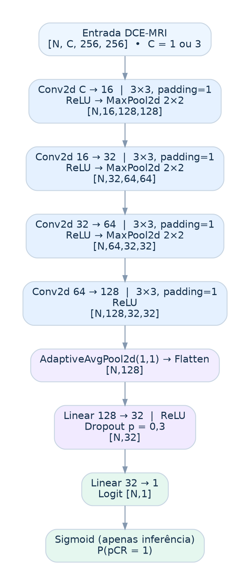

# Documentação técnica — arquiteturas de redes neurais para classificação de pCR

**Disciplina:** Processamento e Análise de Imagens  
**Projeto:** Classificação da resposta patológica completa (pCR) em imagens DCE-MRI do BreastDCEDL I-SPY1 MinCrop  
**Base documental:** `modulos/modulo_redes.py`, `modulos/modulo_dataset.py` e `tests/test_modulo_dataset.py` deste repositório; enunciado da disciplina (seção **d**, pp. 3–4; requisitos do relatório na p. 6).  
**Estado:** descrição fiel das arquiteturas implementadas + **propostas**, claramente identificadas, para treinamento. Não representa um treinamento experimental concluído.

> **Autoria:** material de apoio para estudo e adaptação pelos integrantes do grupo. O enunciado exige autoria dos alunos, justificativas próprias e declaração do uso de ferramentas de IA; não usar este texto como descrição de resultados não realizados.

## 1. Objetivo e contratos de entrada/saída

Os modelos classificam cortes bidimensionais de DCE-MRI de mama, estimando a probabilidade de **pCR presente (classe 1)** versus **ausente (classe 0)**. O tensor de entrada tem formato **`[N, C, H, W]`**, com `C=1` (somente pré-contraste, por padrão no teste atual) ou `C=3` (pré-contraste, pós-contraste precoce, pós-contraste tardio, nesta ordem). `H` e `W` são dimensões espaciais; os arquivos originais possuem planos de 256 × 256 pixels. A CNN também aceita outras dimensões espaciais válidas porque usa pooling adaptativo.

O `forward` retorna **um logit** real por amostra, `shape=[N,1]`. O logit **não é uma probabilidade**; na inferência, `prever_probabilidades()` aplica `torch.sigmoid(logit)` para obter valores em `[0,1]`. Para treinar com `BCEWithLogitsLoss`, **não** aplicar a sigmoid antes da loss.

O módulo `modulos/modulo_dataset.py` implementa **duas opções de seleção de cortes**: central e maior área tumoral. A normalização de cada amostra usa os percentis 1 e 99 em conjunto entre os canais, limitando os valores a `[0,1]`. Essa é uma escolha de pré-processamento, ainda pendente de validação quantitativa e verificação nos volumes NIfTI completos. A comparação de desempenho das duas estratégias será realizada na Issue #4.

## 2. CNN autoral (`CNNSimples`)

A arquitetura tem **quatro convoluções e duas camadas totalmente conectadas: seis camadas com parâmetros treináveis**. As camadas de entrada, ativações, pooling, flatten e dropout não contam como camadas com parâmetros conforme o critério do enunciado. Todas as convoluções usam *bias* (padrão do PyTorch), kernel `3×3`, `stride=1` e `padding=1`.



*Figura 1 — Topologia da `CNNSimples` para cortes de 256 × 256; C indica 1 ou 3 canais. A sigmoid aparece apenas após o logit, na rotina de previsão, não como camada interna do modelo.*

| Etapa | Camada e configuração | Saída para entrada 256 × 256 | Papel |
|---|---|---|---|
| 1 | `Conv2d(C,16,kernel_size=3,padding=1)` + `ReLU` + `MaxPool2d(2)` | `[N,16,128,128]` | Bordas e padrões locais; redução espacial |
| 2 | `Conv2d(16,32,3,padding=1)` + `ReLU` + `MaxPool2d(2)` | `[N,32,64,64]` | Padrões de complexidade intermediária |
| 3 | `Conv2d(32,64,3,padding=1)` + `ReLU` + `MaxPool2d(2)` | `[N,64,32,32]` | Características mais abstratas |
| 4 | `Conv2d(64,128,3,padding=1)` + `ReLU` | `[N,128,32,32]` | Ampliação da representação de características |
| 5 | `AdaptiveAvgPool2d((1,1))` + `Flatten` | `[N,128]` | Reduz a dependência do tamanho espacial |
| 6 | `Linear(128,32)` + `ReLU` + `Dropout(0.3)` | `[N,32]` | Integra características e regulariza |
| 7 | `Linear(32,1)` | `[N,1]` | Produz um logit para classificação binária |
| Inferência | `sigmoid(logit)` (fora do `forward`) | `[N,1]` | Converte logit em probabilidade |

**Contagem exata de parâmetros (verificada por PyTorch):** CNN com 1 canal: **101.313 parâmetros**, todos treináveis. CNN com 3 canais: **101.601 parâmetros**, todos treináveis. A diferença de 288 decorre somente da primeira convolução. Os testes de forma e de gradientes devem ser repetidos na integração;  isso não mede desempenho clínico ou preditivo.

### Justificativas iniciais (hipóteses a validar)

- **Kernel 3×3 e padding 1:** filtros pequenos capturam estruturas locais sem reduzir a resolução nas convoluções.
- **Canais 16 → 32 → 64 → 128:** aumentam gradualmente a capacidade de representação ao passo que as dimensões espaciais diminuem.
- **MaxPool2d(2) nas três primeiras etapas:** reduz o custo computacional e fornece alguma tolerância a pequenos deslocamentos, com perda de resolução como contrapartida.
- **ReLU:** função simples e computacionalmente eficiente; introduz não linearidade.
- **AdaptiveAvgPool2d(1×1):** evita uma camada densa enorme para imagens de 256 × 256 e permite tamanhos espaciais variáveis.
- **Dropout 0,3:** regularização moderada para reduzir coadaptação no classificador; deve ser comparada experimentalmente com alternativas (por exemplo, 0 ou 0,5).
- **Sem sigmoid no `forward`:** necessário para treinamento numericamente estável com `BCEWithLogitsLoss`.

## 3. ResNet50 (`criar_resnet50`)

O código cria `torchvision.models.resnet50(weights=ResNet50_Weights.DEFAULT)` por padrão. A ResNet50 é uma rede residual de aproximadamente 50 camadas, organizada em uma convolução inicial, blocos residuais com conexões de atalho, quatro estágios principais de blocos convolucionais, *global average pooling* e classificador final.

**Topologia conceitual:** `Entrada C×H×W → conv1 + BatchNorm + ReLU + maxpool → layer1 → layer2 → layer3 → layer4 (blocos residuais) → avgpool → fc(2048→1) → logit`.

- O primeiro `Conv2d` é adaptado para **1 canal** somando os pesos dos três canais RGB do filtro original; com **3 canais** é preservado. Isso permite entrada de uma fase ou três fases temporais.
- O modelo usa os pesos disponíveis do ImageNet quando `pre_treinado=True` (podendo exigir download); com `False`, não utiliza pesos ImageNet.
- Os parâmetros do backbone são congelados (`requires_grad=False`), e a camada `fc` é substituída por **`Linear(2048,1)`**, nova e treinável.
- **Parâmetros totais / treináveis**, respectivamente: **23.503.809 / 2.049** (1 canal); **23.510.081 / 2.049** (3 canais). Valores verificados por PyTorch com `pre_treinado=False`; a contagem de parâmetros independe dos pesos carregados.
- **Ativações:** ReLU no backbone; a camada de saída é linear e gera logit, convertido por sigmoid apenas na inferência.

**Justificativa inicial:** o uso de representações pré-treinadas reduz a quantidade de parâmetros atualizados durante o ajuste inicial em um dataset pequeno. Contudo, imagens médicas são diferentes das imagens naturais do ImageNet: a transferência de aprendizado **precisa ser avaliada**, não pressuposta como superior. Congelar parâmetros não impede sozinho a atualização das estatísticas internas do BatchNorm: o módulo de treinamento precisa estabelecer o modo apropriado para o backbone congelado.

## 4. MobileNetV2 (`criar_mobilenetv2`)

O código usa `torchvision.models.mobilenet_v2(weights=MobileNet_V2_Weights.DEFAULT)` por padrão. A MobileNetV2 emprega blocos residuais invertidos (*inverted residuals*) e convoluções separáveis em profundidade (*depthwise separable convolutions*), com objetivo de reduzir o custo computacional.

**Topologia conceitual:** `Entrada C×H×W → convolução inicial → blocos inverted residual (expansão, depthwise, projeção linear e atalhos quando aplicáveis) → convolução final → pooling global → dropout interno do classificador → Linear(1280→1) → logit`.

- O primeiro filtro é adaptado para 1 canal pela soma de pesos RGB ou mantido com 3 canais.
- Os parâmetros de `modelo.features` são congelados; o classificador original tem `Dropout(0.2)` e sua camada linear é substituída por **`Linear(1280,1)`**, treinável.
- **Parâmetros totais / treináveis:** **2.224.577 / 1.281** (1 canal); **2.225.153 / 1.281** (3 canais).
- **Ativações:** ReLU6 em partes da arquitetura; projeções lineares nos blocos de gargalo; camada final linear seguida de sigmoid apenas na inferência.

**Justificativa inicial:** ser mais leve pode facilitar treinamento e inferência em computadores com recursos limitados. Menor custo **não garante** melhor qualidade de classificação, que deverá ser avaliada por paciente.

## 5. Funções de ativação

| Componente | Função | Motivo |
|---|---|---|
| CNN, camadas ocultas | `ReLU(x)=max(0,x)` | Não linearidade eficiente |
| ResNet50, backbone | `ReLU` | Ativação implementada na arquitetura original |
| MobileNetV2, backbone | `ReLU6(x)=min(max(0,x),6)` e projeções lineares | Característica dos blocos originais MobileNetV2 |
| Todas, camada de saída | **Linear (sem ativação)** | Compatibilidade com `BCEWithLogitsLoss` |
| Todas, apenas inferência | `sigmoid(x)=1/(1+exp(-x))` | Probabilidade estimada de classe 1 |

## 6. Otimizador e função de perda — **não definidos no módulo atual**

**Situação no código:** `modulos/modulo_redes.py` só cria arquiteturas e converte logits em probabilidades na inferência. Ele **não implementa** otimizador, treinamento, escolha de taxa de aprendizado, *scheduler*, `pos_weight` ou loss. Essas decisões pertencem ao futuro `modulo_treinamento.py`. Não descrevê-las como já testadas.

**Proposta simples de ponto de partida para experimentos (não validada):**

| Hiperparâmetro | CNN | ResNet50 e MobileNetV2 (somente classificadores) | Justificativa a testar |
|---|---|---|---|
| Otimizador | `Adam` | `Adam` | Bom ponto de partida, com adaptação das taxas por parâmetro |
| Taxa inicial de aprendizado | `1e-3` | `1e-4` | Cabeças pré-treinadas podem exigir ajuste mais conservador; avaliar convergência |
| Weight decay | `1e-4` | `1e-4` | Regularização adicional; observar under/overfitting |
| Loss | `BCEWithLogitsLoss` | `BCEWithLogitsLoss` | Classificação binária com logits e estabilidade numérica |
| Batch size | `8` (proposta) | `8` (proposta) | Reduz demanda de memória; ajustar conforme hardware |
| Épocas máximas | `30` (proposta) | `30` (proposta) | Limite inicial de exploração; a convergência real determinará necessidade |
| Parada antecipada | paciência `5` (proposta) | paciência `5` (proposta) | Evita continuar treinamento se a validação não melhorar |
| Limiar para classe positiva | `0,5` (referência) | `0,5` (referência) | Ponto de partida; seleção/calibração só com validação |

**Exemplo ilustrativo (para discussão e adaptação no módulo de treinamento, não integrado):**

```python
modelo = criar_modelo("cnn", canais_entrada=3)
criterio = torch.nn.BCEWithLogitsLoss()  # sem sigmoid antes da loss
otimizador = torch.optim.Adam(
    (p for p in modelo.parameters() if p.requires_grad),
    lr=1e-3, weight_decay=1e-4,
)
# logits = modelo(imagens)   # [N, 1]
# perda = criterio(logits, rotulos.float().view(-1, 1))
```

**Desbalanceamento:** verificar **apenas o conjunto de treino**. Se a classe 1 estiver sub-representada, considerar `BCEWithLogitsLoss(pos_weight=n_negativos/n_positivos)` a partir da contagem de pacientes de treino, registrando a escolha. Não calcular o peso com validação/teste; evitar duplicar indevidamente a correção combinando pesos e oversampling sem justificativa.

**BatchNorm das redes congeladas:** no treinamento, colocar a parte de extração de características em modo `eval()` quando se optar por manter fixas suas estatísticas; selecionar os parâmetros treináveis no otimizador. A política exata precisa ser testada, pois o estado `train()/eval()` é diferente de `requires_grad`.

## 7. Demais hiperparâmetros implementados

| Item | Valor exato no código | Status |
|---|---|---|
| CNN: filtros | 16, 32, 64, 128 | Implementado |
| CNN: kernel | 3×3 | Implementado |
| CNN: padding | 1 | Implementado |
| CNN: pooling | MaxPool 2×2 após as três primeiras convoluções | Implementado |
| CNN: pooling adaptativo | 1×1 | Implementado |
| CNN: unidade densa oculta | 32 | Implementado |
| CNN: dropout | 0,3 | Implementado |
| ResNet50: cabeça final | Linear 2048→1 | Implementado |
| MobileNetV2: cabeça final | Linear 1280→1; Dropout 0,2 original | Implementado |
| ResNet50/MobileNetV2: backbone | Congelado em `requires_grad` | Implementado |
| 1 vs. 3 canais | Soma dos filtros RGB iniciais quando C=1 | Implementado |
| Inicialização pré-treinada | `Weights.DEFAULT` para modelos transferidos | Configurável; não demonstrada no teste sem pesos |
| Corte por paciente | Central ou maior área da máscara | Implementado em `modulos/modulo_dataset.py`, não na rede |
| Intensidade | Normalização conjunta dos canais por percentis 1–99 em [0,1] | Implementada em `modulos/modulo_dataset.py`; ainda não validada experimentalmente |

## 8. Experimentos e limitações que o relatório deve registrar

1. **Não confundir inferência correta com modelo treinado:** o teste de integração confirma execução e formatos, não sensibilidade, especificidade ou acurácia.
2. **Comparar 1 vs. 3 fases** com protocolos de treinamento e teste equivalentes.
3. **Comparar ao menos duas estratégias de cortes:** por exemplo, corte de maior área tumoral versus corte central, ou agregação das probabilidades por média; definir o resultado **por paciente**, evitando vazamento entre partições.
4. **Definir/confirmar os códigos de partição do CSV oficial** antes de treinar, como alerta o `modulo_dataset.py`.
5. **Registrar curvas loss treino/validação, tempo de treino, precisão, acurácia, sensibilidade, especificidade, F1, exemplos de erros e acertos**, conforme o enunciado.
6. **Realizar avaliação de hiperparâmetros**, reportando escolhas e diferenças observadas em validação, em vez de apresentar justificativas propostas como resultados experimentais.
7. **Grad-CAM:** validar visualmente se as ativações se relacionam ao tumor e evitar interpretar o mapa como prova causal.
8. **Limitações:** poucos pacientes, possível desbalanceamento, diferença entre ImageNet e DCE-MRI, dependência da qualidade da segmentação e possibilidade de sobreajuste.

## 9. Texto-base para adaptação no relatório

> Desenvolvemos uma CNN 2D com quatro camadas convolucionais e duas totalmente conectadas, totalizando seis camadas com parâmetros. As convoluções utilizam kernels 3×3, padding 1 e ativações ReLU, com filtros 16, 32, 64 e 128. As três primeiras convoluções são seguidas de max pooling 2×2. Ao final, o pooling médio adaptativo transforma os mapas em 128 atributos, utilizados por uma camada densa de 32 unidades e pela saída binária. Como arquiteturas adicionais, configuramos ResNet50 e MobileNetV2 do Torchvision para transferência de aprendizado, congelando os extratores de características e substituindo o classificador final por uma unidade. Todas as arquiteturas retornam logits, transformados por sigmoid somente na inferência. **[Completar com metodologia real de treinamento, hiperparâmetros efetivamente usados e resultados experimentais.]**

## 10. Referências de implementação e documentação

- Código-fonte do projeto: `modulos/modulo_redes.py` (arquiteturas), `tests/test_modulo_dataset.py` (testes automatizados do dataset, incluindo dados sintéticos) e `modulos/modulo_dataset.py` (metadados, volumes e cortes).
- PyTorch: `torch.nn.Conv2d`, `ReLU`, `MaxPool2d`, `AdaptiveAvgPool2d`, `Dropout`, `Linear`, `BCEWithLogitsLoss`, `Adam`: <https://pytorch.org/docs/stable/nn.html> e <https://pytorch.org/docs/stable/optim.html>.
- Torchvision Models: `resnet50` e `mobilenet_v2`: <https://pytorch.org/vision/stable/models.html>.
- Enunciado da disciplina, seções *Especificações do programa* e *Documentação* (2026).
- **Registro de IAG:** documentar ferramenta, finalidade e prompts conforme instruído no enunciado, com revisão autoral pelo grupo.
