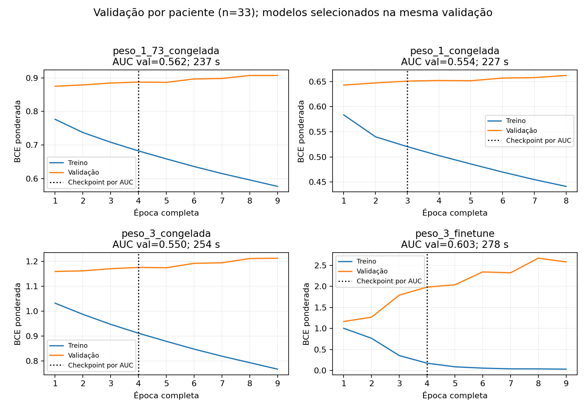
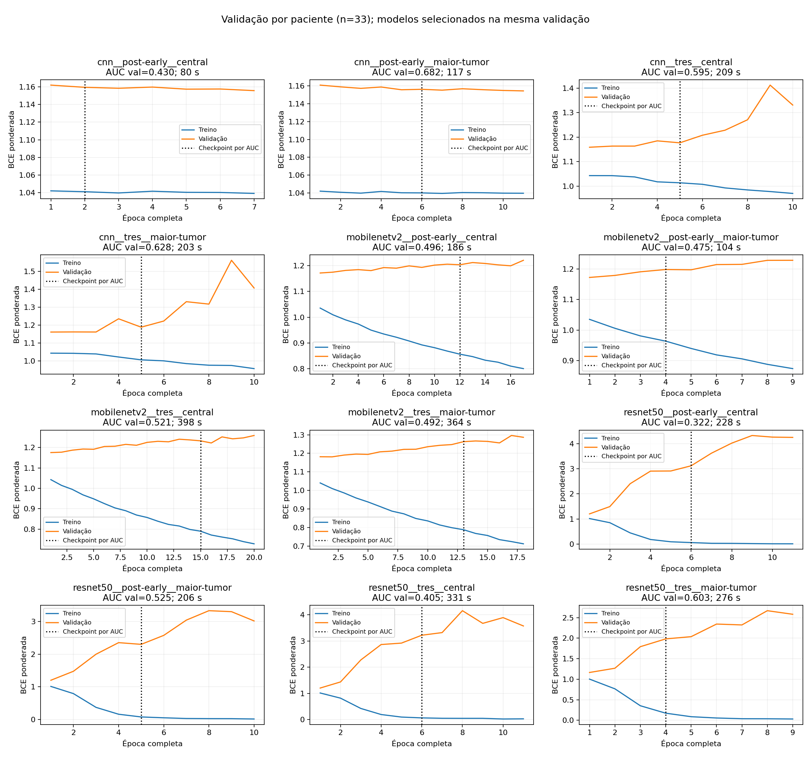
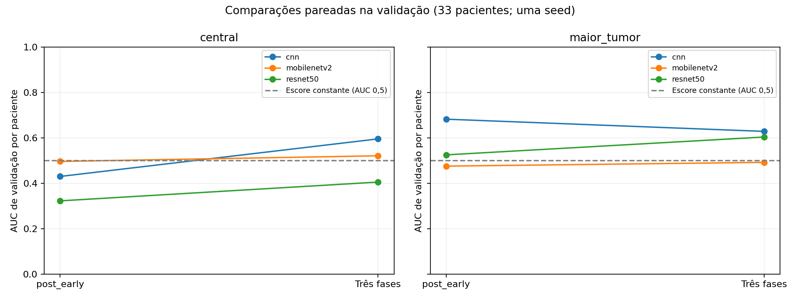
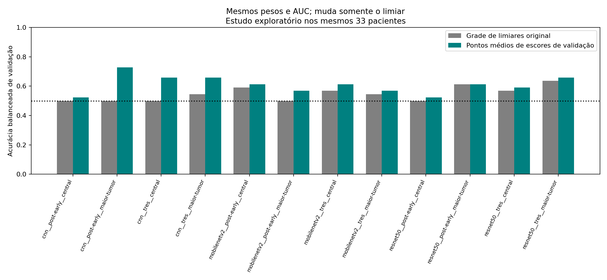
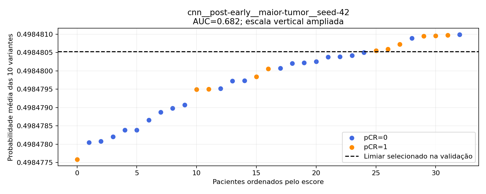

# Issue #4 — revisão anterior ao teste final

**Etapas de ajuste e validação concluídas. Avaliação final no teste não executada.**
Nenhum merge na develop ou fechamento da issue foi realizado.

CUDA corrigido na `.venv`: PyTorch 2.9.1+cu126 / torchvision 0.24.1+cu126; GTX 1650 SUPER.
36 testes automatizados passaram, além dos smoke tests das três redes na GPU.
Partições: 104 treino, 33 validação, 35 teste; aumento ×10 somente em treino/validação.
As cinco métricas, AUC e acurácia balanceada são calculadas por paciente após média das probabilidades.
Loss é a média da BCE ponderada nas amostras aumentadas; os 330 exemplos de validação não são 330 pacientes independentes.

## Ajustes iniciais (ResNet50, três fases, maior tumor)

| Candidato | AUC | Ac. bal. | F1 | Sens. | Espec. | Loss | Época/total | Tempo (s) |
|---|---:|---:|---:|---:|---:|---:|---:|---:|
| peso_3_finetune | 0.6033 | 0.6364 | 0.4706 | 0.3636 | 0.9091 | 1.9822 | 4/9 | 278.0 |
| peso_1_73_congelada | 0.5620 | 0.5909 | 0.5000 | 0.6364 | 0.5455 | 0.8874 | 4/9 | 236.6 |
| peso_1_congelada | 0.5537 | 0.5682 | 0.4828 | 0.6364 | 0.5000 | 0.6507 | 3/8 | 227.2 |
| peso_3_congelada | 0.5496 | 0.5682 | 0.2857 | 0.1818 | 0.9545 | 1.1756 | 4/9 | 254.4 |

Escolha anterior à grade: peso 3,0 e fine-tuning de layer4 na ResNet50 pela maior AUC.
A escolha não elimina o forte sobreajuste observado nem prova melhora nas demais combinações.

## Grade de 12 configurações e estudo de limiares

Os pesos, épocas, AUCs e tempos são os mesmos nas duas versões. A versão suplementar muda apenas o limiar,
usando pontos médios entre escores distintos de validação, extremos internos e 0,5. Critério: acurácia balanceada;
desempate: especificidade, sensibilidade e proximidade de 0,5. A versão original com passo 0,05 foi preservada.
Este refinamento foi motivado por inspeção da validação durante a grade; é exploratório e foi aplicado uniformemente às 12 configurações.

| Configuração | AUC | Ac. bal. original | Ac. bal. refinada | F1 original | F1 refinado | Positivos previstos/33 |
|---|---:|---:|---:|---:|---:|---:|
| cnn__post-early__maior-tumor | 0.6818 | 0.5000 | 0.7273 | 0.0000 | 0.6316 | 8 |
| cnn__tres__maior-tumor | 0.6281 | 0.5455 | 0.6591 | 0.3810 | 0.5882 | 23 |
| resnet50__tres__maior-tumor | 0.6033 | 0.6364 | 0.6591 | 0.4706 | 0.5263 | 8 |
| cnn__tres__central | 0.5950 | 0.5000 | 0.6591 | 0.0000 | 0.5806 | 20 |
| resnet50__post-early__maior-tumor | 0.5248 | 0.6136 | 0.6136 | 0.4000 | 0.4000 | 4 |
| mobilenetv2__tres__central | 0.5207 | 0.5682 | 0.6136 | 0.2857 | 0.4000 | 4 |
| mobilenetv2__post-early__central | 0.4959 | 0.5909 | 0.6136 | 0.3750 | 0.4000 | 4 |
| mobilenetv2__tres__maior-tumor | 0.4917 | 0.5455 | 0.5682 | 0.5238 | 0.4348 | 12 |
| mobilenetv2__post-early__maior-tumor | 0.4752 | 0.5000 | 0.5682 | 0.0000 | 0.5263 | 27 |
| cnn__post-early__central | 0.4298 | 0.5000 | 0.5227 | 0.0000 | 0.1538 | 2 |
| resnet50__tres__central | 0.4050 | 0.5682 | 0.5909 | 0.3529 | 0.3750 | 5 |
| resnet50__post-early__central | 0.3223 | 0.5000 | 0.5227 | 0.0000 | 0.5116 | 32 |

| Configuração | Sens. | Espec. | Precisão | Acurácia | Loss | Época/total | Tempo (s) |
|---|---:|---:|---:|---:|---:|---:|---:|---:|
| cnn__post-early__maior-tumor | 0.5455 | 0.9091 | 0.7500 | 0.7879 | 1.1563 | 6/11 | 117.1 |
| cnn__tres__maior-tumor | 0.9091 | 0.4091 | 0.4348 | 0.5758 | 1.1882 | 5/10 | 203.1 |
| resnet50__tres__maior-tumor | 0.4545 | 0.8636 | 0.6250 | 0.7273 | 1.9822 | 4/9 | 276.5 |
| cnn__tres__central | 0.8182 | 0.5000 | 0.4500 | 0.6061 | 1.1770 | 5/10 | 208.5 |
| resnet50__post-early__maior-tumor | 0.2727 | 0.9545 | 0.7500 | 0.7273 | 2.3017 | 5/10 | 206.1 |
| mobilenetv2__tres__central | 0.2727 | 0.9545 | 0.7500 | 0.7273 | 1.2330 | 15/20 | 398.2 |
| mobilenetv2__post-early__central | 0.2727 | 0.9545 | 0.7500 | 0.7273 | 1.2036 | 12/17 | 186.4 |
| mobilenetv2__tres__maior-tumor | 0.4545 | 0.6818 | 0.4167 | 0.6061 | 1.2630 | 13/18 | 363.7 |
| mobilenetv2__post-early__maior-tumor | 0.9091 | 0.2273 | 0.3704 | 0.4545 | 1.1983 | 4/9 | 103.6 |
| cnn__post-early__central | 0.0909 | 0.9545 | 0.5000 | 0.6667 | 1.1595 | 2/7 | 80.0 |
| resnet50__tres__central | 0.2727 | 0.9091 | 0.6000 | 0.6970 | 3.2192 | 6/11 | 331.2 |
| resnet50__post-early__central | 1.0000 | 0.0455 | 0.3438 | 0.3636 | 3.1194 | 6/11 | 228.1 |

Tabela completa com limiares sem arredondamento, hiperparâmetros, TN/FP/FN/TP e hashes: [auditoria_limiares.csv](auditoria_limiares.csv).
Comparação antes/depois: [comparacao_limiares.csv](grade_limiares_validacao/comparacao_limiares.csv).

## Configuração escolhida exclusivamente pela validação

**cnn__post-early__maior-tumor__seed-42**; época 6; limiar completo **0.49848052859306335**.
AUC=0.6818; ac. balanceada=0.7273; F1=0.6316; sensibilidade=0.5455; especificidade=0.9091.
Precisão=0.7500; acurácia=0.7879; TN=20, FP=2, FN=5, TP=6.
Checkpoint: `checkpoints\execucao_issue4_20261117_01\grade_limiares_validacao\cnn__post-early__maior-tumor__seed-42.pt`. SHA-256: `206bc055e52464cd3144ab833eb92c3e835beb9d6d9bde2022eeafe027807d0b`.
Adam; LR=0.001; weight decay=0.0001; peso positivo=3.0; batch=4; seed=42; máximo de 30 épocas, paciência 5.
Época por AUC de validação (empate por loss); modelo por AUC (desempates: ac. balanceada, sensibilidade, loss e nome).
Normalização: percentis 1/99 conjuntos por amostra, clip [0,1]; corte e fases conforme o nome da configuração.

## Efeito das três fases na validação

| Rede | Corte | AUC uma fase | AUC três fases | ΔAUC (três − uma) |
|---|---|---:|---:|---:|
| cnn | central | 0.4298 | 0.5950 | +0.1653 |
| cnn | maior_tumor | 0.6818 | 0.6281 | -0.0537 |
| mobilenetv2 | central | 0.4959 | 0.5207 | +0.0248 |
| mobilenetv2 | maior_tumor | 0.4752 | 0.4917 | +0.0165 |
| resnet50 | central | 0.3223 | 0.4050 | +0.0826 |
| resnet50 | maior_tumor | 0.5248 | 0.6033 | +0.0785 |

## Efeito do corte na validação

| Rede | Fases | AUC central | AUC maior tumor | ΔAUC (maior − central) |
|---|---|---:|---:|---:|
| cnn | post_early | 0.4298 | 0.6818 | +0.2521 |
| cnn | tres | 0.5950 | 0.6281 | +0.0331 |
| mobilenetv2 | post_early | 0.4959 | 0.4752 | -0.0207 |
| mobilenetv2 | tres | 0.5207 | 0.4917 | -0.0289 |
| resnet50 | post_early | 0.3223 | 0.5248 | +0.2025 |
| resnet50 | tres | 0.4050 | 0.6033 | +0.1983 |

## Limitações e verificações

- Os mesmos 33 pacientes servem para escolher época, limiar e configuração. Métricas de validação são otimistas; uma seed e 12 configurações não sustentam alegação de superioridade robusta.
- No estudo inicial o fine-tuning reduziu fortemente a loss de treino e aumentou a de validação: sobreajuste. A CNN de fase única manteve loss de treino perto de 1,04: aprendizagem discriminativa limitada.
- Na CNN de fase única/maior tumor, escores entre 0,4984775841 e 0,4984809875 tornam o limiar numericamente sensível. O ganho de F1 vem da escolha do limiar na validação, sem melhora dos pesos ou AUC. Não arredondar o limiar de aplicação.
- Teste não aumentado e validação com média das 10 variantes seguem o protocolo; as distribuições de escore podem diferir. Não adaptar o limiar depois de consultar o teste.
- Losses de candidatos com pesos de classe diferentes não são diretamente comparáveis. Tempos incluem preparação por época e execução num Windows com outros aplicativos, não um benchmark isolado.
- O grupo já consultou os resultados originais do teste antes desta revisão. Portanto, o teste não é completamente cego; nenhuma nova métrica de teste orientou esta execução.
- 12 checkpoints originais e 12 cópias com limiares refinados foram recarregados estritamente em CPU. Cada cópia preserva todos os tensores de pesos da origem; os quatro candidatos também foram auditados.
- Recarga com inferência na validação: maior diferença de probabilidade=0.0; classificações divergentes=0. Essa verificação na mesma GPU não prova estabilidade entre ambientes.
- Os artefatos anteriores à sessão tiveram seus hashes conferidos. Dados e pesos não devem entrar no ZIP principal de entrega.

## Figuras

## Próxima etapa depende da revisão do usuário

A avaliação final dos 12 modelos nos 35 pacientes de teste aguarda revisão destes resultados e da configuração. Depois de autorizada, executar uma única vez e não usar métricas do teste para novo ajuste. Nenhum merge ou fechamento da issue deve preceder a validação final.

O protocolo, diagnóstico do Windows, decisões e prompt de IAG estão em `docs/EXECUCAO_ISSUE_4_20261117.md`.
