# Issue #4 — resultados finais da coorte de 27 checkpoints

Resultados reais: A=12 originais, B=3 intermediários, C=12 novos. 12 representantes fixados antes do teste; quatro por arquitetura. Teste: mesmos 35 pacientes, sem augmentation, limiares de validação inalterados. Rankings do teste são descritivos e não mudam os selecionados.

CNN inclui as variantes ReLU, LeakyReLU e GroupNorm. post_early=uma fase; tres=pre/post_early/post_late; central=corte Z//2; maior_tumor=maior área da máscara. A loss é BCE ponderada com pos_weight=3. No treino/validação inclui as dez variantes; métricas usam média por paciente.

## Validação dos 27

| codigo | arquitetura | fases | corte | auc_roc | sensibilidade | especificidade | precisao | acuracia | f1 | acuracia_balanceada | loss | epoca | tempo_treinamento_segundos |
|---|---|---|---|---|---|---|---|---|---|---|---|---|---|
| A01 | cnn | post_early | central | 0.4298 | 0.0909 | 0.9545 | 0.5000 | 0.6667 | 0.1538 | 0.5227 | 1.1595 | 2 | 80.0135 |
| A02 | cnn | post_early | maior_tumor | 0.6818 | 0.5455 | 0.9091 | 0.7500 | 0.7879 | 0.6316 | 0.7273 | 1.1563 | 6 | 117.0938 |
| A03 | cnn | tres | central | 0.5950 | 0.8182 | 0.5000 | 0.4500 | 0.6061 | 0.5806 | 0.6591 | 1.1770 | 5 | 208.5038 |
| A04 | cnn | tres | maior_tumor | 0.6281 | 0.9091 | 0.4091 | 0.4348 | 0.5758 | 0.5882 | 0.6591 | 1.1882 | 5 | 203.0725 |
| A05 | mobilenetv2 | post_early | central | 0.4959 | 0.2727 | 0.9545 | 0.7500 | 0.7273 | 0.4000 | 0.6136 | 1.2036 | 12 | 186.4065 |
| A06 | mobilenetv2 | post_early | maior_tumor | 0.4752 | 0.9091 | 0.2273 | 0.3704 | 0.4545 | 0.5263 | 0.5682 | 1.1983 | 4 | 103.6074 |
| A07 | mobilenetv2 | tres | central | 0.5207 | 0.2727 | 0.9545 | 0.7500 | 0.7273 | 0.4000 | 0.6136 | 1.2330 | 15 | 398.2285 |
| A08 | mobilenetv2 | tres | maior_tumor | 0.4917 | 0.4545 | 0.6818 | 0.4167 | 0.6061 | 0.4348 | 0.5682 | 1.2630 | 13 | 363.6608 |
| A09 | resnet50 | post_early | central | 0.3223 | 1.0000 | 0.0455 | 0.3438 | 0.3636 | 0.5116 | 0.5227 | 3.1194 | 6 | 228.1142 |
| A10 | resnet50 | post_early | maior_tumor | 0.5248 | 0.2727 | 0.9545 | 0.7500 | 0.7273 | 0.4000 | 0.6136 | 2.3017 | 5 | 206.0805 |
| A11 | resnet50 | tres | central | 0.4050 | 0.2727 | 0.9091 | 0.6000 | 0.6970 | 0.3750 | 0.5909 | 3.2192 | 6 | 331.2207 |
| A12 | resnet50 | tres | maior_tumor | 0.6033 | 0.4545 | 0.8636 | 0.6250 | 0.7273 | 0.5263 | 0.6591 | 1.9822 | 4 | 276.4946 |
| B01 | cnn | post_early | maior_tumor | 0.6694 | 0.7273 | 0.6818 | 0.5333 | 0.6970 | 0.6154 | 0.7045 | 1.1612 | 3 | 91.4704 |
| B02 | cnn | post_early | maior_tumor | 0.5702 | 0.7273 | 0.5000 | 0.4211 | 0.5758 | 0.5333 | 0.6136 | 1.1598 | 2 | 82.3987 |
| B03 | resnet50 | tres | maior_tumor | 0.5785 | 0.2727 | 1.0000 | 1.0000 | 0.7576 | 0.4286 | 0.6364 | 1.1432 | 1 | 178.3819 |
| C01 | cnn | post_early | central | 0.5372 | 0.2727 | 0.9545 | 0.7500 | 0.7273 | 0.4000 | 0.6136 | 1.1579 | 2 | 82.6979 |
| C02 | cnn | post_early | maior_tumor | 0.5331 | 0.6364 | 0.6364 | 0.4667 | 0.6364 | 0.5385 | 0.6364 | 1.1683 | 14 | 213.4724 |
| C03 | cnn | tres | central | 0.5909 | 0.9091 | 0.4091 | 0.4348 | 0.5758 | 0.5882 | 0.6591 | 1.2958 | 16 | 445.0624 |
| C04 | cnn | tres | maior_tumor | 0.5455 | 0.0909 | 1.0000 | 1.0000 | 0.6970 | 0.1667 | 0.5455 | 1.1590 | 9 | 303.7189 |
| C05 | resnet50 | post_early | central | 0.3471 | 0.0909 | 0.9545 | 0.5000 | 0.6667 | 0.1538 | 0.5227 | 2.3729 | 1 | 126.2144 |
| C06 | resnet50 | post_early | maior_tumor | 0.5785 | 0.3636 | 1.0000 | 1.0000 | 0.7879 | 0.5333 | 0.6818 | 4.5556 | 2 | 145.7056 |
| C07 | resnet50 | tres | central | 0.4463 | 0.5455 | 0.5000 | 0.3529 | 0.5152 | 0.4286 | 0.5227 | 7.6089 | 6 | 329.0278 |
| C08 | resnet50 | tres | maior_tumor | 0.5496 | 0.3636 | 0.8636 | 0.5714 | 0.6970 | 0.4444 | 0.6136 | 1.7532 | 1 | 200.8648 |
| C09 | mobilenetv2 | post_early | central | 0.5372 | 0.9091 | 0.2727 | 0.3846 | 0.4848 | 0.5405 | 0.5909 | 2.0535 | 11 | 194.3133 |
| C10 | mobilenetv2 | post_early | maior_tumor | 0.4959 | 1.0000 | 0.1364 | 0.3667 | 0.4242 | 0.5366 | 0.5682 | 1.5984 | 6 | 136.4487 |
| C11 | mobilenetv2 | tres | central | 0.6488 | 0.8182 | 0.5000 | 0.4500 | 0.6061 | 0.5806 | 0.6591 | 2.4516 | 15 | 436.7035 |
| C12 | mobilenetv2 | tres | maior_tumor | 0.5661 | 0.4545 | 0.7727 | 0.5000 | 0.6667 | 0.4762 | 0.6136 | 1.5717 | 5 | 232.6820 |

A tabela CSV acrescenta intervenção, limiar com precisão completa, confusão e estabilidade.

## Representantes e escolhas anteriores ao teste

| codigo | arquitetura | fases | corte | auc_roc_validacao | acuracia_balanceada_validacao | auc_roc | acuracia_balanceada |
|---|---|---|---|---|---|---|---|
| A02 | cnn | post_early | maior_tumor | 0.6818 | 0.7273 | 0.5109 | 0.4964 |
| A03 | cnn | tres | central | 0.5950 | 0.6591 | 0.5616 | 0.5181 |
| A04 | cnn | tres | maior_tumor | 0.6281 | 0.6591 | 0.5942 | 0.5181 |
| A12 | resnet50 | tres | maior_tumor | 0.6033 | 0.6591 | 0.5761 | 0.6178 |
| C01 | cnn | post_early | central | 0.5372 | 0.6136 | 0.4058 | 0.3659 |
| C05 | resnet50 | post_early | central | 0.3471 | 0.5227 | 0.5543 | 0.5616 |
| C06 | resnet50 | post_early | maior_tumor | 0.5785 | 0.6818 | 0.5688 | 0.5598 |
| C07 | resnet50 | tres | central | 0.4463 | 0.5227 | 0.7101 | 0.6377 |
| C09 | mobilenetv2 | post_early | central | 0.5372 | 0.5909 | 0.4783 | 0.5707 |
| C10 | mobilenetv2 | post_early | maior_tumor | 0.4959 | 0.5682 | 0.5761 | 0.5236 |
| C11 | mobilenetv2 | tres | central | 0.6488 | 0.6591 | 0.5652 | 0.5072 |
| C12 | mobilenetv2 | tres | maior_tumor | 0.5661 | 0.6136 | 0.5435 | 0.5362 |

AUC de validação é primária; desempates previamente registrados no plano. Diferenças numéricas pequenas não comprovam superioridade estatística.

- Melhor cnn pela validação: **A02**, `cnn__post-early__maior-tumor__seed-42`.
- Melhor resnet50 pela validação: **A12**, `resnet50__tres__maior-tumor__seed-42`.
- Melhor mobilenetv2 pela validação: **C11**, `c_mobilenetv2_tres_central`.

Vencedor geral pela validação: **A02**, `cnn__post-early__maior-tumor__seed-42`.

- Maior BA observada no teste: **C07**, `c_resnet50_tres_central`.
- Maior AUC observada no teste: **C07**, `c_resnet50_tres_central`.
- Maior F1 observado no teste: **C07**, `c_resnet50_tres_central`.
- Maior AUC observada no treino, no checkpoint já escolhido: **C09**, `c_mobilenetv2_post_early_central`.

## Ranking A — todos os 27 no teste

| posicao | codigo | grupo | arquitetura | fases | corte | sensibilidade | especificidade | precisao | acuracia | f1 | acuracia_balanceada | auc_roc | loss |
|---|---|---|---|---|---|---|---|---|---|---|---|---|---|
| 1 | C07 | C | resnet50 | tres | central | 0.6667 | 0.6087 | 0.4706 | 0.6286 | 0.5517 | 0.6377 | 0.7101 | 3.8854 |
| 2 | B03 | B | resnet50 | tres | maior_tumor | 0.4167 | 0.8261 | 0.5556 | 0.6857 | 0.4762 | 0.6214 | 0.5652 | 1.1493 |
| 3 | A12 | A | resnet50 | tres | maior_tumor | 0.5833 | 0.6522 | 0.4667 | 0.6286 | 0.5185 | 0.6178 | 0.5761 | 1.9116 |
| 4 | C08 | C | resnet50 | tres | maior_tumor | 0.4167 | 0.7391 | 0.4545 | 0.6286 | 0.4348 | 0.5779 | 0.5942 | 1.4797 |
| 5 | C09 | C | mobilenetv2 | post_early | central | 0.7500 | 0.3913 | 0.3913 | 0.5143 | 0.5143 | 0.5707 | 0.4783 | 2.4045 |
| 6 | A09 | A | resnet50 | post_early | central | 1.0000 | 0.1304 | 0.3750 | 0.4286 | 0.5455 | 0.5652 | 0.4457 | 2.3955 |
| 7 | C05 | C | resnet50 | post_early | central | 0.1667 | 0.9565 | 0.6667 | 0.6857 | 0.2667 | 0.5616 | 0.5543 | 1.8995 |
| 8 | C06 | C | resnet50 | post_early | maior_tumor | 0.2500 | 0.8696 | 0.5000 | 0.6571 | 0.3333 | 0.5598 | 0.5688 | 4.4470 |
| 9 | A06 | A | mobilenetv2 | post_early | maior_tumor | 0.8333 | 0.2609 | 0.3704 | 0.4571 | 0.5128 | 0.5471 | 0.5471 | 1.1749 |
| 10 | C04 | C | cnn | tres | maior_tumor | 0.0833 | 1.0000 | 1.0000 | 0.6857 | 0.1538 | 0.5417 | 0.5417 | 1.1726 |
| 11 | C12 | C | mobilenetv2 | tres | maior_tumor | 0.3333 | 0.7391 | 0.4000 | 0.6000 | 0.3636 | 0.5362 | 0.5435 | 1.7563 |
| 12 | C10 | C | mobilenetv2 | post_early | maior_tumor | 0.9167 | 0.1304 | 0.3548 | 0.4000 | 0.5116 | 0.5236 | 0.5761 | 1.4232 |
| 13 | A04 | A | cnn | tres | maior_tumor | 0.1667 | 0.8696 | 0.4000 | 0.6286 | 0.2353 | 0.5181 | 0.5942 | 1.1676 |
| 14 | A03 | A | cnn | tres | central | 0.1667 | 0.8696 | 0.4000 | 0.6286 | 0.2353 | 0.5181 | 0.5616 | 1.1861 |
| 15 | A11 | A | resnet50 | tres | central | 0.2500 | 0.7826 | 0.3750 | 0.6000 | 0.3000 | 0.5163 | 0.5507 | 1.6127 |
| 16 | C11 | C | mobilenetv2 | tres | central | 0.6667 | 0.3478 | 0.3478 | 0.4571 | 0.4571 | 0.5072 | 0.5652 | 2.4129 |
| 17 | A02 | A | cnn | post_early | maior_tumor | 0.1667 | 0.8261 | 0.3333 | 0.6000 | 0.2222 | 0.4964 | 0.5109 | 1.1696 |
| 18 | A01 | A | cnn | post_early | central | 0.1667 | 0.8261 | 0.3333 | 0.6000 | 0.2222 | 0.4964 | 0.3859 | 1.1732 |
| 19 | A10 | A | resnet50 | post_early | maior_tumor | 0.0833 | 0.8696 | 0.2500 | 0.6000 | 0.1250 | 0.4764 | 0.5580 | 2.0144 |
| 20 | B01 | B | cnn | post_early | maior_tumor | 0.4167 | 0.5217 | 0.3125 | 0.4857 | 0.3571 | 0.4692 | 0.4710 | 1.1751 |
| 21 | B02 | B | cnn | post_early | maior_tumor | 0.5000 | 0.4348 | 0.3158 | 0.4571 | 0.3871 | 0.4674 | 0.4964 | 1.1735 |
| 22 | A07 | A | mobilenetv2 | tres | central | 0.1667 | 0.7391 | 0.2500 | 0.5429 | 0.2000 | 0.4529 | 0.5217 | 1.2325 |
| 23 | C03 | C | cnn | tres | central | 0.5000 | 0.3913 | 0.3000 | 0.4286 | 0.3750 | 0.4457 | 0.4094 | 1.4553 |
| 24 | A08 | A | mobilenetv2 | tres | maior_tumor | 0.4167 | 0.4348 | 0.2778 | 0.4286 | 0.3333 | 0.4257 | 0.4022 | 1.3071 |
| 25 | A05 | A | mobilenetv2 | post_early | central | 0.0000 | 0.8261 | 0.0000 | 0.5429 | 0.0000 | 0.4130 | 0.5688 | 1.1974 |
| 26 | C02 | C | cnn | post_early | maior_tumor | 0.1667 | 0.6087 | 0.1818 | 0.4571 | 0.1739 | 0.3877 | 0.5145 | 1.1830 |
| 27 | C01 | C | cnn | post_early | central | 0.1667 | 0.5652 | 0.1667 | 0.4286 | 0.1667 | 0.3659 | 0.4058 | 1.1736 |

## Ranking B — os 12 representantes no teste

| posicao | codigo | grupo | arquitetura | fases | corte | sensibilidade | especificidade | precisao | acuracia | f1 | acuracia_balanceada | auc_roc | loss |
|---|---|---|---|---|---|---|---|---|---|---|---|---|---|
| 1 | C07 | C | resnet50 | tres | central | 0.6667 | 0.6087 | 0.4706 | 0.6286 | 0.5517 | 0.6377 | 0.7101 | 3.8854 |
| 2 | A12 | A | resnet50 | tres | maior_tumor | 0.5833 | 0.6522 | 0.4667 | 0.6286 | 0.5185 | 0.6178 | 0.5761 | 1.9116 |
| 3 | C09 | C | mobilenetv2 | post_early | central | 0.7500 | 0.3913 | 0.3913 | 0.5143 | 0.5143 | 0.5707 | 0.4783 | 2.4045 |
| 4 | C05 | C | resnet50 | post_early | central | 0.1667 | 0.9565 | 0.6667 | 0.6857 | 0.2667 | 0.5616 | 0.5543 | 1.8995 |
| 5 | C06 | C | resnet50 | post_early | maior_tumor | 0.2500 | 0.8696 | 0.5000 | 0.6571 | 0.3333 | 0.5598 | 0.5688 | 4.4470 |
| 6 | C12 | C | mobilenetv2 | tres | maior_tumor | 0.3333 | 0.7391 | 0.4000 | 0.6000 | 0.3636 | 0.5362 | 0.5435 | 1.7563 |
| 7 | C10 | C | mobilenetv2 | post_early | maior_tumor | 0.9167 | 0.1304 | 0.3548 | 0.4000 | 0.5116 | 0.5236 | 0.5761 | 1.4232 |
| 8 | A04 | A | cnn | tres | maior_tumor | 0.1667 | 0.8696 | 0.4000 | 0.6286 | 0.2353 | 0.5181 | 0.5942 | 1.1676 |
| 9 | A03 | A | cnn | tres | central | 0.1667 | 0.8696 | 0.4000 | 0.6286 | 0.2353 | 0.5181 | 0.5616 | 1.1861 |
| 10 | C11 | C | mobilenetv2 | tres | central | 0.6667 | 0.3478 | 0.3478 | 0.4571 | 0.4571 | 0.5072 | 0.5652 | 2.4129 |
| 11 | A02 | A | cnn | post_early | maior_tumor | 0.1667 | 0.8261 | 0.3333 | 0.6000 | 0.2222 | 0.4964 | 0.5109 | 1.1696 |
| 12 | C01 | C | cnn | post_early | central | 0.1667 | 0.5652 | 0.1667 | 0.4286 | 0.1667 | 0.3659 | 0.4058 | 1.1736 |

Ordem: BA decrescente, F1 decrescente, AUC decrescente, ID. Rankings complementares por AUC e F1 estão em `artigo/`.

## Correspondência dos códigos, pesos e resultados

- **A01** `cnn__post-early__central__seed-42`: peso local `checkpoints/execucao_issue4_20261117_01/grade_limiares_validacao/cnn__post-early__central__seed-42.pt`; limiar `0.4938041865825653`; época 2; 7 épocas completas; intervenção: grade original.
- **A02** `cnn__post-early__maior-tumor__seed-42`: peso local `checkpoints/execucao_issue4_20261117_01/grade_limiares_validacao/cnn__post-early__maior-tumor__seed-42.pt`; limiar `0.49848052859306335`; época 6; 11 épocas completas; intervenção: grade original.
- **A03** `cnn__tres__central__seed-42`: peso local `checkpoints/execucao_issue4_20261117_01/grade_limiares_validacao/cnn__tres__central__seed-42.pt`; limiar `0.47722066491842274`; época 5; 10 épocas completas; intervenção: grade original.
- **A04** `cnn__tres__maior-tumor__seed-42`: peso local `checkpoints/execucao_issue4_20261117_01/grade_limiares_validacao/cnn__tres__maior-tumor__seed-42.pt`; limiar `0.4819288983941078`; época 5; 10 épocas completas; intervenção: grade original.
- **A05** `mobilenetv2__post-early__central__seed-42`: peso local `checkpoints/execucao_issue4_20261117_01/grade_limiares_validacao/mobilenetv2__post-early__central__seed-42.pt`; limiar `0.566841208934784`; época 12; 17 épocas completas; intervenção: grade original.
- **A06** `mobilenetv2__post-early__maior-tumor__seed-42`: peso local `checkpoints/execucao_issue4_20261117_01/grade_limiares_validacao/mobilenetv2__post-early__maior-tumor__seed-42.pt`; limiar `0.42850990891456603`; época 4; 9 épocas completas; intervenção: grade original.
- **A07** `mobilenetv2__tres__central__seed-42`: peso local `checkpoints/execucao_issue4_20261117_01/grade_limiares_validacao/mobilenetv2__tres__central__seed-42.pt`; limiar `0.5431677505373955`; época 15; 20 épocas completas; intervenção: grade original.
- **A08** `mobilenetv2__tres__maior-tumor__seed-42`: peso local `checkpoints/execucao_issue4_20261117_01/grade_limiares_validacao/mobilenetv2__tres__maior-tumor__seed-42.pt`; limiar `0.4458016857504845`; época 13; 18 épocas completas; intervenção: grade original.
- **A09** `resnet50__post-early__central__seed-42`: peso local `checkpoints/execucao_issue4_20261117_01/grade_limiares_validacao/resnet50__post-early__central__seed-42.pt`; limiar `0.010471966626937501`; época 6; 11 épocas completas; intervenção: grade original.
- **A10** `resnet50__post-early__maior-tumor__seed-42`: peso local `checkpoints/execucao_issue4_20261117_01/grade_limiares_validacao/resnet50__post-early__maior-tumor__seed-42.pt`; limiar `0.756848182529211`; época 5; 10 épocas completas; intervenção: grade original.
- **A11** `resnet50__tres__central__seed-42`: peso local `checkpoints/execucao_issue4_20261117_01/grade_limiares_validacao/resnet50__tres__central__seed-42.pt`; limiar `0.7724838942289352`; época 6; 11 épocas completas; intervenção: grade original.
- **A12** `resnet50__tres__maior-tumor__seed-42`: peso local `checkpoints/execucao_issue4_20261117_01/grade_limiares_validacao/resnet50__tres__maior-tumor__seed-42.pt`; limiar `0.3762133240699768`; época 4; 9 épocas completas; intervenção: grade original.
- **B01** `e1_cnn_lr_menor`: peso local `checkpoints/rodada_final_issue4_20261117_01/e1_cnn_lr_menor__cnn__post-early__maior-tumor__seed-42.pt`; limiar `0.4913703888654709`; época 3; 8 épocas completas; intervenção: e1_cnn_lr_menor.
- **B02** `e2_cnn_leaky`: peso local `checkpoints/rodada_final_issue4_20261117_01/e2_cnn_leaky__cnn-leaky__post-early__maior-tumor__seed-42.pt`; limiar `0.49338732063770296`; época 2; 7 épocas completas; intervenção: e2_cnn_leaky.
- **B03** `e3_resnet_imagenet`: peso local `checkpoints/rodada_final_issue4_20261117_01/e3_resnet_imagenet__resnet50__tres__maior-tumor__seed-42.pt`; limiar `0.5356386035680771`; época 1; 6 épocas completas; intervenção: e3_resnet_imagenet.
- **C01** `c_cnn_post_early_central`: peso local `checkpoints/grade_definitiva_issue4_20261117_01/c_cnn_post_early_central__cnn-groupnorm__post-early__central__seed-42.pt`; limiar `0.4987002074718475`; época 2; 7 épocas completas; intervenção: GroupNorm(4) entre cada Conv e ReLU.
- **C02** `c_cnn_post_early_maior_tumor`: peso local `checkpoints/grade_definitiva_issue4_20261117_01/c_cnn_post_early_maior_tumor__cnn-groupnorm__post-early__maior-tumor__seed-42.pt`; limiar `0.4819885969161987`; época 14; 19 épocas completas; intervenção: GroupNorm(4) entre cada Conv e ReLU.
- **C03** `c_cnn_tres_central`: peso local `checkpoints/grade_definitiva_issue4_20261117_01/c_cnn_tres_central__cnn-groupnorm__tres__central__seed-42.pt`; limiar `0.3083760604262352`; época 16; 21 épocas completas; intervenção: GroupNorm(4) entre cada Conv e ReLU.
- **C04** `c_cnn_tres_maior_tumor`: peso local `checkpoints/grade_definitiva_issue4_20261117_01/c_cnn_tres_maior_tumor__cnn-groupnorm__tres__maior-tumor__seed-42.pt`; limiar `0.4945214733481407`; época 9; 14 épocas completas; intervenção: GroupNorm(4) entre cada Conv e ReLU.
- **C05** `c_resnet50_post_early_central`: peso local `checkpoints/grade_definitiva_issue4_20261117_01/c_resnet50_post_early_central__resnet50__post-early__central__seed-42.pt`; limiar `0.6023294270038605`; época 1; 6 épocas completas; intervenção: layer4+fc; todas BN affine/estatisticas congeladas.
- **C06** `c_resnet50_post_early_maior_tumor`: peso local `checkpoints/grade_definitiva_issue4_20261117_01/c_resnet50_post_early_maior_tumor__resnet50__post-early__maior-tumor__seed-42.pt`; limiar `0.5`; época 2; 7 épocas completas; intervenção: layer4+fc; todas BN affine/estatisticas congeladas.
- **C07** `c_resnet50_tres_central`: peso local `checkpoints/grade_definitiva_issue4_20261117_01/c_resnet50_tres_central__resnet50__tres__central__seed-42.pt`; limiar `0.014535749325091274`; época 6; 11 épocas completas; intervenção: layer4+fc; todas BN affine/estatisticas congeladas.
- **C08** `c_resnet50_tres_maior_tumor`: peso local `checkpoints/grade_definitiva_issue4_20261117_01/c_resnet50_tres_maior_tumor__resnet50__tres__maior-tumor__seed-42.pt`; limiar `0.45322845429182057`; época 1; 6 épocas completas; intervenção: layer4+fc; todas BN affine/estatisticas congeladas.
- **C09** `c_mobilenetv2_post_early_central`: peso local `checkpoints/grade_definitiva_issue4_20261117_01/c_mobilenetv2_post_early_central__mobilenetv2__post-early__central__seed-42.pt`; limiar `0.09664575625211`; época 11; 16 épocas completas; intervenção: features[17:19]+classifier; todas BN congeladas.
- **C10** `c_mobilenetv2_post_early_maior_tumor`: peso local `checkpoints/grade_definitiva_issue4_20261117_01/c_mobilenetv2_post_early_maior_tumor__mobilenetv2__post-early__maior-tumor__seed-42.pt`; limiar `0.09836509246379138`; época 6; 11 épocas completas; intervenção: features[17:19]+classifier; todas BN congeladas.
- **C11** `c_mobilenetv2_tres_central`: peso local `checkpoints/grade_definitiva_issue4_20261117_01/c_mobilenetv2_tres_central__mobilenetv2__tres__central__seed-42.pt`; limiar `0.061849540378898386`; época 15; 20 épocas completas; intervenção: features[17:19]+classifier; todas BN congeladas.
- **C12** `c_mobilenetv2_tres_maior_tumor`: peso local `checkpoints/grade_definitiva_issue4_20261117_01/c_mobilenetv2_tres_maior_tumor__mobilenetv2__tres__maior-tumor__seed-42.pt`; limiar `0.3731868088245392`; época 5; 10 épocas completas; intervenção: features[17:19]+classifier; todas BN congeladas.

## Artefatos para o artigo

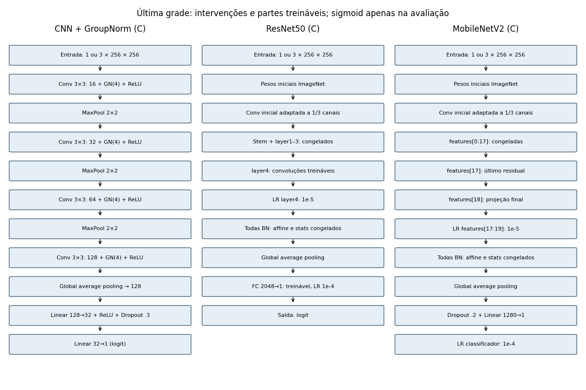

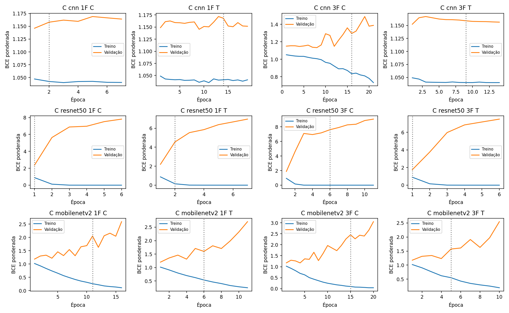

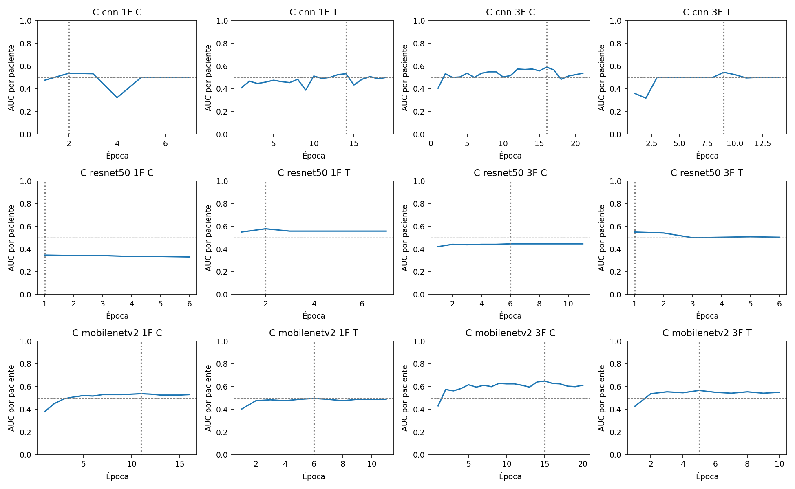

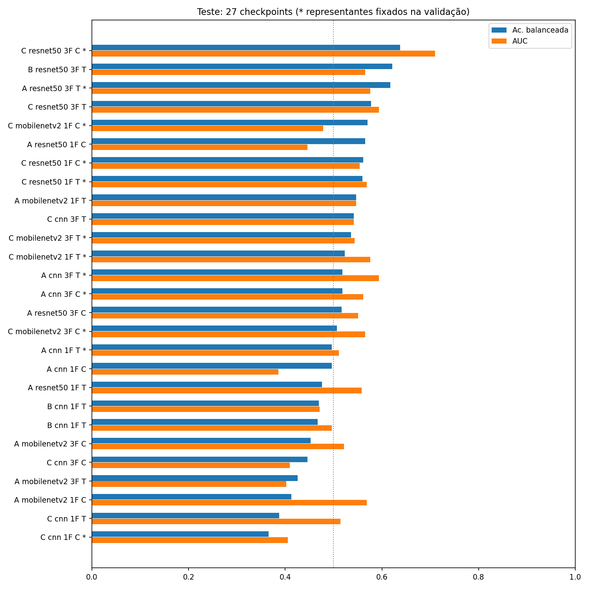

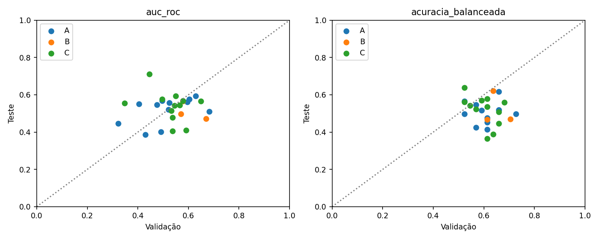

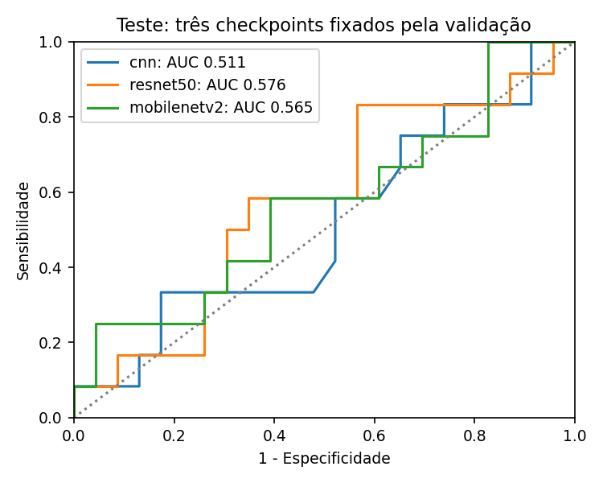

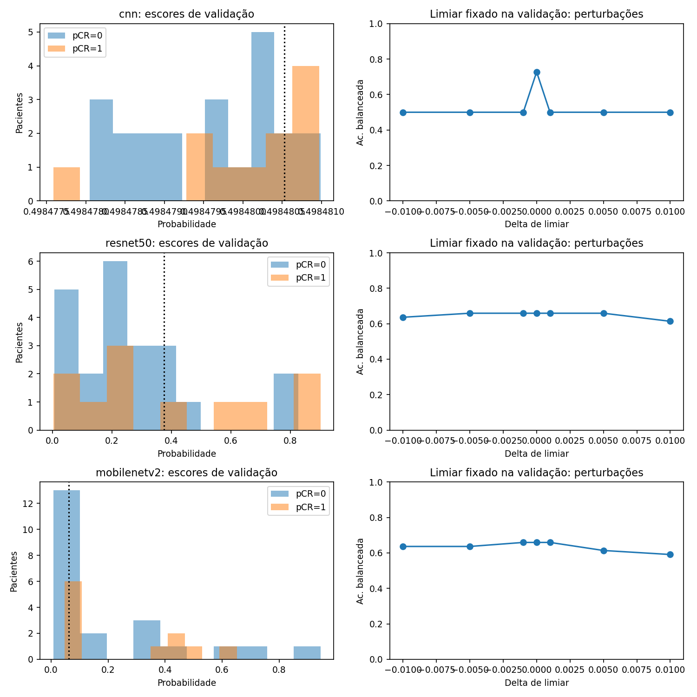

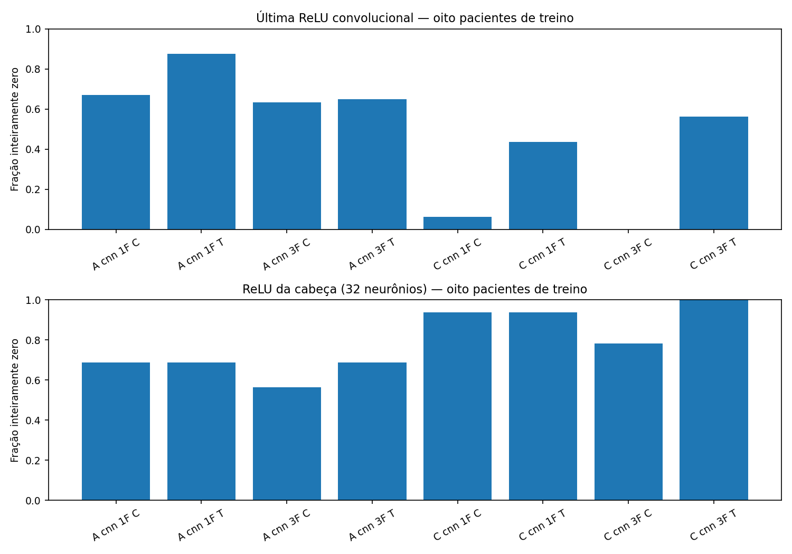

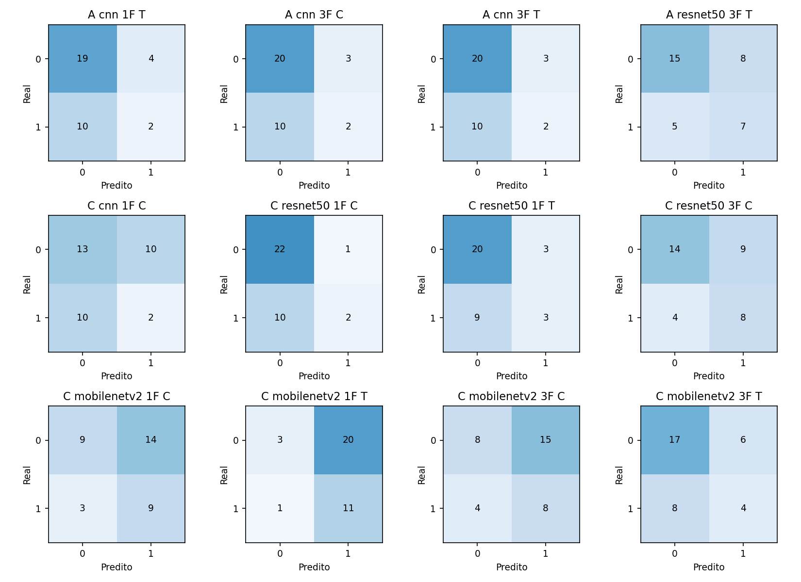

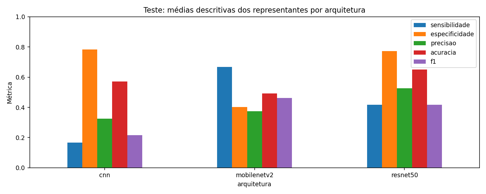

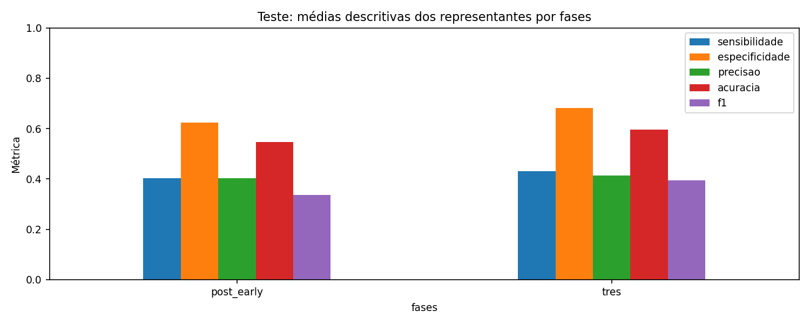

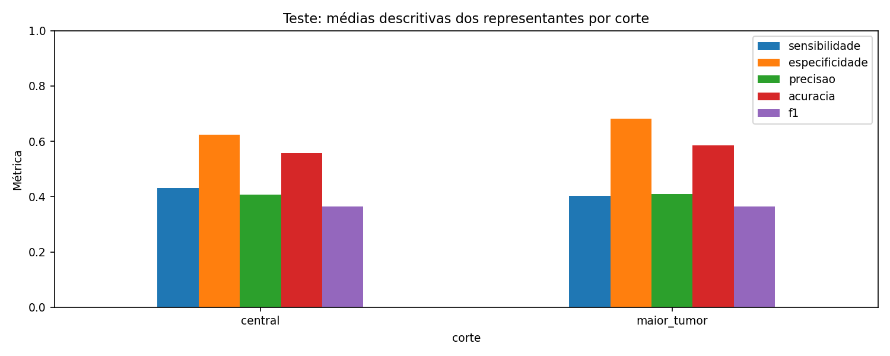

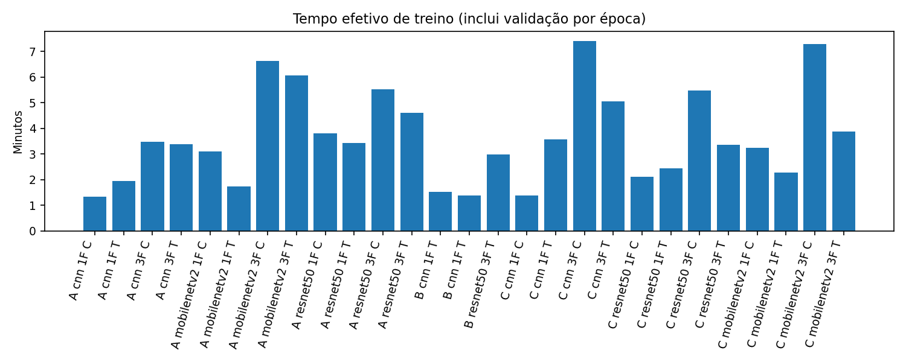

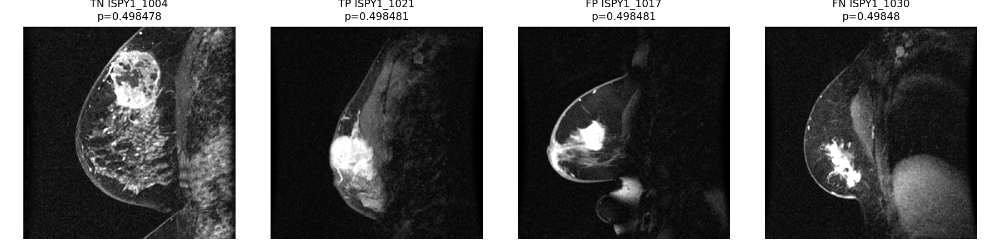

## Limites e integração

Dataset pequeno; validação reutilizada; dez aumentos não são dez pacientes. Uma seed e uma partição não demonstram robustez externa. Consultas históricas ao teste em outra branch impedem chamar o teste de completamente cego; não são atribuídas a esta execução. Não houve novos ajustes após a avaliação final.

Preservar todos os pesos localmente. Para apresentação usar vencedor da validação, destacar melhor por arquitetura e os 12 representantes. Não enviar os 27 pesos no ZIP de 10 MB. Integração em Python único, interface/Grad-CAM e artigo SBC dependem de revisão dos integrantes. Nenhum merge ou fechamento foi realizado.

Uso de IAG: Codex/OpenAI auxiliou código, planejamento, execução, análise e redação. Os integrantes devem revisar e validar todas essas partes antes de entrega. Prompt e finalidades estão em `docs/PROMPT_GRADE_DEFINITIVA_ISSUE_4_20261117.md`.

## Discussão e verificação final

A análise das 15 questões solicitadas, dos resultados negativos, dos contrastes
controlados e da proposta de apresentação está no
[documento definitivo](../../docs/GRADE_DEFINITIVA_ISSUE_4_20261117.md).
Oito checkpoints empataram em AUC de treino 1,0; o primeiro listado nos destaques
não é um vencedor único de treinamento. Esses empates não alteram a seleção.

C07 liderou BA/AUC/F1 observados no teste (0,6377/0,7101/0,5517), mas a CNN A02
continua vencedora pela validação. A02 caiu para AUC 0,5109 e BA 0,4964 no teste;
esse resultado negativo deve aparecer no artigo. B03 ficou em segundo no ranking
de BA, porém não substitui A12 como representante de três fases/maior tumor.

**58 testes aprovados** e auditoria das métricas com scikit-learn concluída;
27 checkpoints recarregados novamente em CPU após o teste, sem nova inferência.
Os 266 artefatos anteriores foram preservados. Nenhum ajuste após o teste.

Figura revisada para evitar sobreposição de rótulos, mantendo a versão original:

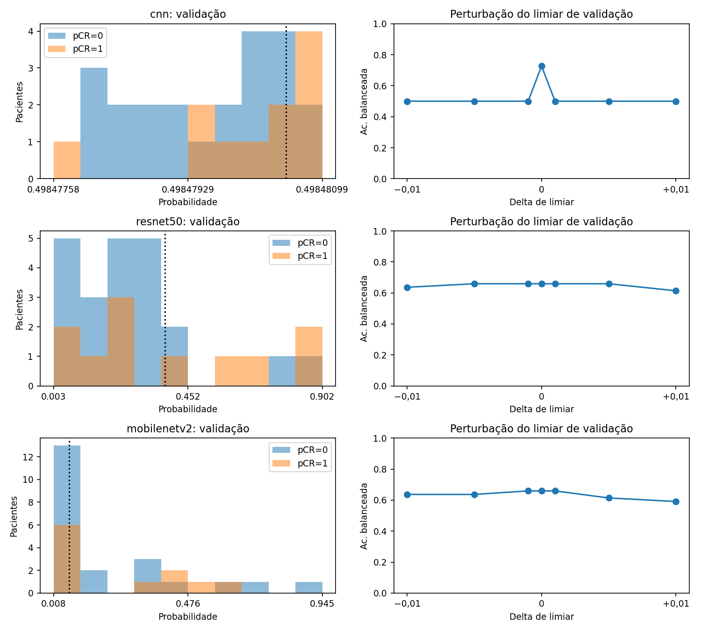

[Versão PDF para LaTeX](artigo/figuras_revisadas/probabilidades_e_limiares.pdf).

Ranking revisado com códigos únicos para distinguir todas as variantes:

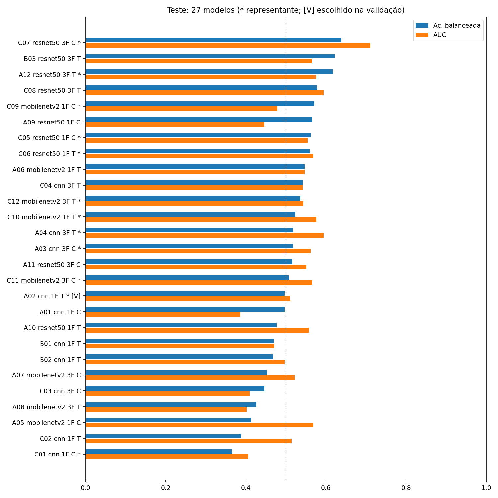

[Ranking em PDF para LaTeX](artigo/figuras_revisadas/ranking_teste_27.pdf).
